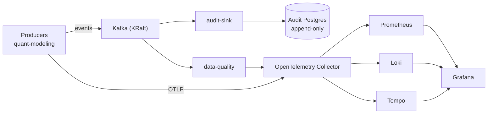

# quant-platform

A self-hosted event bus, append-only audit trail and observability stack for the
quant projects running on one server. Its first producer is
[quant-modeling](https://github.com/HadrienT/quant-modeling).

**[How it works: interactive map](https://hadrient.github.io/atlas-pages/quant-platform/)**

[](https://github.com/HadrienT/quant-platform/actions/workflows/ci.yml)
[](LICENSE)


It exists to answer a question a pricing service cannot answer alone: *what did this
price depend on last Tuesday, and do we get the same number today?* It lives apart
from the pricing code because a platform has another life cycle: redeploying an API
must not restart Kafka.

## Architecture



| Concern | Component |
|---|---|
| Business events (valuations, auth, fallbacks) | Apache Kafka in KRaft mode |
| Audit trail | Dedicated Postgres, append-only, monthly partitions |
| Data quality | Independent consumer group: fallbacks, degraded valuations, silent producers |
| Metrics, logs, traces | OpenTelemetry Collector to Prometheus, Loki and Tempo |
| Dashboards and alerts | Grafana, provisioned from files |
| Schema contract | Apicurio Registry and Avro (optional) |

## Design highlights

- **Effectively-once from at-least-once.** Every event carries a UUID v7 `event_id`
  that the sink uses as its idempotency key.
- **A real contract.** The event envelope has an executable JSON Schema, and topics
  are defined in code.
- **No raw IP addresses.** Producers emit an HMAC, so bursts stay detectable while the
  address is not recoverable from the audit trail.
- **Failure is rehearsed.** Scripts exercise crash recovery of the sink and the
  data-quality worker, and a disposable lab covers disk loss, rebalancing, replay and
  SASL.
- **Local by default.** Nothing is published outside `127.0.0.1`. Other projects join
  through the external Docker network `dataplatform`.

## Getting started

```bash
scripts/bootstrap.sh && scripts/init_env.sh   # tooling and a .env with random secrets
scripts/up.sh                                 # the whole platform
scripts/smoke.sh                              # produce → Kafka → sink → Postgres
```

## Documentation

All in French.

| File | Contents |
|---|---|
| [`docs/RUNBOOK.md`](docs/RUNBOOK.md) | Bringing it up and operating it |
| [`docs/contract.md`](docs/contract.md) | Contract between producers and the platform |
| [`blueprint/decisions.md`](blueprint/decisions.md) | Design decisions, with the alternatives rejected |
| [`docs/exercices.md`](docs/exercices.md) | Operator exercises, with observed outputs |

## License

[MIT](LICENSE)
